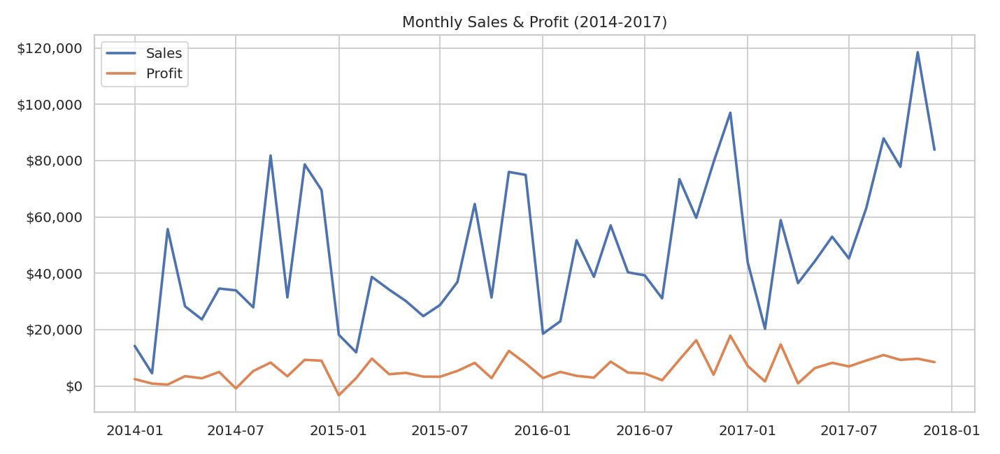
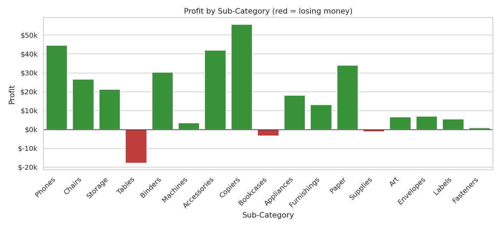
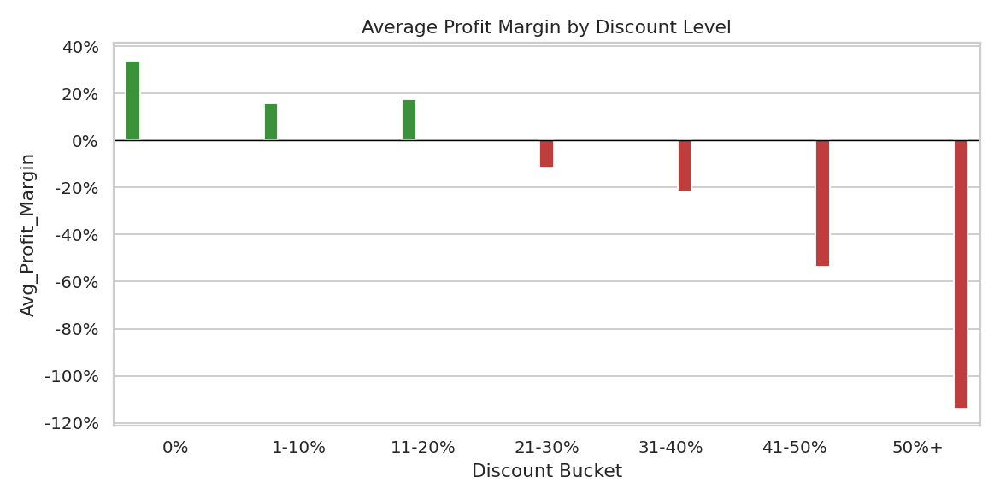

# 🛒 E-Commerce Sales Analytics & Forecasting Dashboard

**End-to-end analysis of a US retail superstore's sales data** — from raw transactions to
actionable business recommendations — featuring RFM customer segmentation, geographic
profitability mapping, discount-impact analysis, and a 6-month sales forecast, delivered
through both a written analysis notebook and a live interactive dashboard.


---

## 📖 Table of Contents

- [Overview](#-overview)
- [Motivation](#-motivation)
- [Problem Statement](#-problem-statement)
- [Key Features](#-key-features)
- [Tech Stack](#-tech-stack)
- [Architecture & Workflow](#-architecture--workflow)
- [Folder Structure](#-folder-structure)
- [Installation](#-installation)
- [How to Run](#-how-to-run)
- [Usage Examples](#-usage-examples)
- [Sample Output & Screenshots](#-sample-output--screenshots)
- [Key Business Insights](#-key-business-insights)
- [Future Improvements](#-future-improvements)
- [Challenges & Lessons Learned](#-challenges--lessons-learned)
- [Contributing](#-contributing)
- [License](#-license)
- [Author](#-author)

---

## 🔍 Overview

This project analyzes ~10,000 transactions (2014–2017) from the well-known **Sample
Superstore** retail dataset to answer a set of concrete business questions: which products
and regions are actually profitable (not just high-revenue), which customers are most
valuable, how discounting affects margin, and what sales are likely to look like in the
coming months.

The project is intentionally structured as **two complementary deliverables**:

1. **`notebooks/exploratory_analysis.ipynb`** — a static, narrative analysis with embedded
   charts and written business insights after every section (readable directly on GitHub,
   no setup required).
2. **`dashboard/app.py`** — a live **Streamlit** app where the exact same analysis becomes
   interactive: filter by date range, region, category, and customer segment, and watch
   every KPI, chart, and the sales forecast update instantly.

All analysis logic lives in a shared, tested `src/` package, so both deliverables are
guaranteed to be consistent with each other — there is no duplicated or diverging logic.

## 💡 Motivation

Most beginner data-analysis portfolio projects stop at "here are some pretty charts."
The goal of this project was to go further and demonstrate the full skill set a
data/business analyst is actually hired for:

- Translating raw numbers into **specific, actionable recommendations**
- Structuring analysis code like production software (modular `src/`, not one giant script)
- Applying a real customer-analytics technique (**RFM segmentation**), not just groupby charts
- Building a **forecasting model** with a defensible methodology (not a black box)
- Delivering results in a format a non-technical stakeholder could actually use (a dashboard)

## ❓ Problem Statement

A retail superstore has three years of order data but no clear answer to basic
profitability questions:

- Is the business growing, and is it seasonal?
- Which product lines *look* profitable on a sales report but actually aren't?
- Is the discounting strategy helping close sales, or quietly destroying margin?
- Which customers deserve retention investment, and which have already been lost?
- Which US states are strong markets, and which need a pricing/logistics audit?
- What should the business expect for sales over the next two quarters?

This project answers each of these questions with data, not intuition.

## ✨ Key Features

- 📈 **Time-series trend analysis** with clear seasonality detection
- 🗂️ **Category / Sub-Category profitability breakdown** — surfaces loss-making product lines
- 💸 **Discount-vs-margin analysis** — identifies the exact discount level where profit turns negative
- 👥 **RFM customer segmentation** (Champions / Loyal / At Risk / Lost / etc.)
- 🗺️ **Geographic (state-level) profitability mapping** with an interactive US choropleth
- 🔮 **6-month sales forecast** using Holt-Winters Exponential Smoothing (trend + seasonality)
- 🖥️ **Interactive Streamlit dashboard** with live filters (date range, region, category, segment)
- 🧩 **Modular, reusable analysis code** (`src/`) shared between the notebook and the dashboard

## 🛠️ Tech Stack

| Purpose | Tool |
|---|---|
| Data manipulation | `pandas`, `numpy` |
| Static visualization (notebook) | `matplotlib`, `seaborn` |
| Interactive visualization (dashboard) | `plotly` |
| Dashboard framework | `streamlit` |
| Time-series forecasting | `statsmodels` (Holt-Winters Exponential Smoothing) |
| Notebook environment | `jupyter` |

> **Why matplotlib in the notebook but Plotly in the dashboard?** GitHub renders `matplotlib`
> output as static images directly in the notebook preview, so anyone browsing the repo sees
> fully-rendered charts immediately. `Plotly`, which needs JavaScript, is reserved for the
> Streamlit dashboard, where it *is* interactive. Using Plotly in the notebook instead would
> make the charts appear blank on GitHub — a common mistake this project deliberately avoids.

## 🏗️ Architecture & Workflow

```
Raw CSV (data/superstore.csv)
        │
        ▼
src/data_loader.py  ──► cleans data, parses dates, engineers features
        │
        ▼
src/sales_analysis.py         src/customer_segmentation.py         src/forecasting.py         src/geo_analysis.py
   (KPIs, trends,                    (RFM scoring)                  (Holt-Winters)              (state summaries)
   category/discount analysis)
        │                                   │                             │                          │
        └───────────────┬───────────────────┴──────────────┬──────────────┴──────────────────────────┘
                         ▼                                  ▼
        notebooks/exploratory_analysis.ipynb        dashboard/app.py (Streamlit)
           (static narrative + insights)              (live interactive filters)
```

Both consumers (the notebook and the dashboard) import the **same** `src/` functions —
there is exactly one implementation of every metric, so results can never silently diverge
between the "report" and the "live tool."

## 📁 Folder Structure

```
superstore-sales-insights/
├── README.md
├── LICENSE
├── .gitignore
├── requirements.txt
├── data/
│   └── superstore.csv              # Raw source data
├── notebooks/
│   └── exploratory_analysis.ipynb  # Full narrative analysis with insights
├── src/                             # Shared, reusable analysis logic
│   ├── __init__.py
│   ├── data_loader.py               # Loading + cleaning + feature engineering
│   ├── sales_analysis.py            # KPIs, trends, category & discount analysis
│   ├── customer_segmentation.py     # RFM scoring & segment labeling
│   ├── forecasting.py               # Holt-Winters sales forecasting
│   └── geo_analysis.py              # State-level aggregation & US state-code mapping
├── dashboard/
│   └── app.py                       # Interactive Streamlit dashboard
├── images/                          # Exported chart screenshots for this README
└── reports/                         # (reserved for future exported PDF/HTML reports)
```

## ⚙️ Installation

```bash
# 1. Clone the repository
git clone https://github.com/nadakhadim33/superstore-sales-insights.git
cd superstore-sales-insights

# 2. (Recommended) create a virtual environment
python -m venv venv
source venv/bin/activate        # on Windows: venv\Scripts\activate

# 3. Install dependencies
pip install -r requirements.txt
```

**Requirements:** Python 3.10+ (see `requirements.txt` for exact package versions).

## ▶️ How to Run

**Option A — Explore the written analysis (notebook):**
```bash
jupyter notebook notebooks/exploratory_analysis.ipynb
```

**Option B — Launch the interactive dashboard:**
```bash
streamlit run dashboard/app.py
```
Then open the URL Streamlit prints in your terminal (typically `http://localhost:8501`).

## 🧪 Usage Examples

The `src/` modules are also usable standalone, e.g. in a Python shell or another script:

```python
from src.data_loader import load_clean_data
from src.customer_segmentation import compute_rfm, segment_summary

df = load_clean_data()
rfm = compute_rfm(df)
print(segment_summary(rfm))
```

## 🖼️ Sample Output & Screenshots

**Monthly sales & profit trend (from the notebook):**



**Profit by sub-category — the "hidden losses" chart:**



**Discount level vs. average profit margin:**



**🎥 Live demo — the Streamlit dashboard in action:**

📽️

https://github.com/user-attachments/assets/cdfe1271-828f-4516-9051-7fe31bb41586


https://github.com/user-attachments/assets/128a8bc5-30d4-4526-8cd6-378ce06d79e0


https://github.com/user-attachments/assets/33ae6a54-b3d8-4a33-be56-3967453ac90a


https://github.com/user-attachments/assets/f35318e8-974c-4682-8dd2-ac037f1e2b4b


https://github.com/user-attachments/assets/91524b6e-31ce-4c5b-bc6e-94e320c16588


> GitHub renders short repo-hosted video files inline in most cases; if it doesn't play
> directly above on your repo page, click the link to view/download it.

## 📊 Key Business Insights

| # | Finding | Recommendation |
|---|---|---|
| 1 | Sales are strongly seasonal, peaking every Nov–Dec | Align inventory & marketing spend with the seasonal cycle |
| 2 | Furniture generates high revenue but a near-zero 2.5% profit margin | Review Furniture pricing & supplier costs |
| 3 | Tables and Bookcases lose money outright (-$17.7k and -$3.5k) | Cap discount approval on these sub-categories |
| 4 | Profit margin turns negative once discounts exceed ~20% | Introduce a max-discount policy requiring manager approval above it |
| 5 | The Home Office segment converts sales to profit most efficiently | Consider increased investment toward Home Office customers |
| 6 | 107 "At Risk" customers were historically high-value but haven't ordered in ~171 days | Launch a targeted win-back campaign |
| 7 | Texas & Pennsylvania have high sales but negative overall profit | Audit regional discounting practices in these states |
| 8 | The forecast shows a predictable Q1 sales dip | Adjust inventory & staffing planning for the seasonal trough |

*(Full methodology and supporting charts for every row above are in
`notebooks/exploratory_analysis.ipynb`.)*

## 🚀 Future Improvements

- Add automated data-quality tests (e.g. `pytest` + `great_expectations`) for the `src/` pipeline
- Deploy the Streamlit dashboard publicly (Streamlit Community Cloud) and link it here
- Add a customer-churn *prediction* model (not just RFM description) using scikit-learn
- Support multi-year, multi-country datasets instead of the current single-country sample
- Add cohort retention analysis alongside RFM segmentation
- Export the executive summary automatically as a PDF report (`reports/`)

## 🧗 Challenges & Lessons Learned

- **GitHub cannot render interactive Plotly charts** embedded in a notebook — solved by using
  `matplotlib`/`seaborn` for the notebook's static narrative and reserving `Plotly` for the
  genuinely interactive Streamlit dashboard.
- **Headless chart export (`kaleido`) requires a full Chrome install**, which isn't always
  available in restricted/sandboxed environments — this reinforced the decision above to keep
  the two visualization layers separate rather than depending on a heavyweight browser install.
- **Discount level, not weak demand, was the real driver of unprofitable product lines** — this
  only became clear after explicitly bucketing orders by discount percentage (Section 6 of the
  notebook), rather than stopping at a category-level profit summary.
- Keeping every metric definition in one shared `src/` package (instead of copy-pasting pandas
  code into both the notebook and the dashboard) made it easy to trust that the two views of the
  data would never silently disagree.

## 🤝 Contributing

Contributions, issues, and feature requests are welcome. Feel free to check the
[issues page](../../issues) or open a pull request.

1. Fork the project
2. Create your feature branch (`git checkout -b feature/amazing-feature`)
3. Commit your changes (`git commit -m 'Add some amazing feature'`)
4. Push to the branch (`git push origin feature/amazing-feature`)
5. Open a Pull Request

## 📄 License

This project is licensed under the MIT License — see the [LICENSE](LICENSE) file for details.

## 👤 Author

**Nada Khadim**
- GitHub: [@nadakhadim33](https://github.com/nadakhadim33)

---

*Dataset: "Sample Superstore" — a widely used public sample retail dataset for BI/analytics
practice (originally distributed with Tableau's sample workbooks).*
